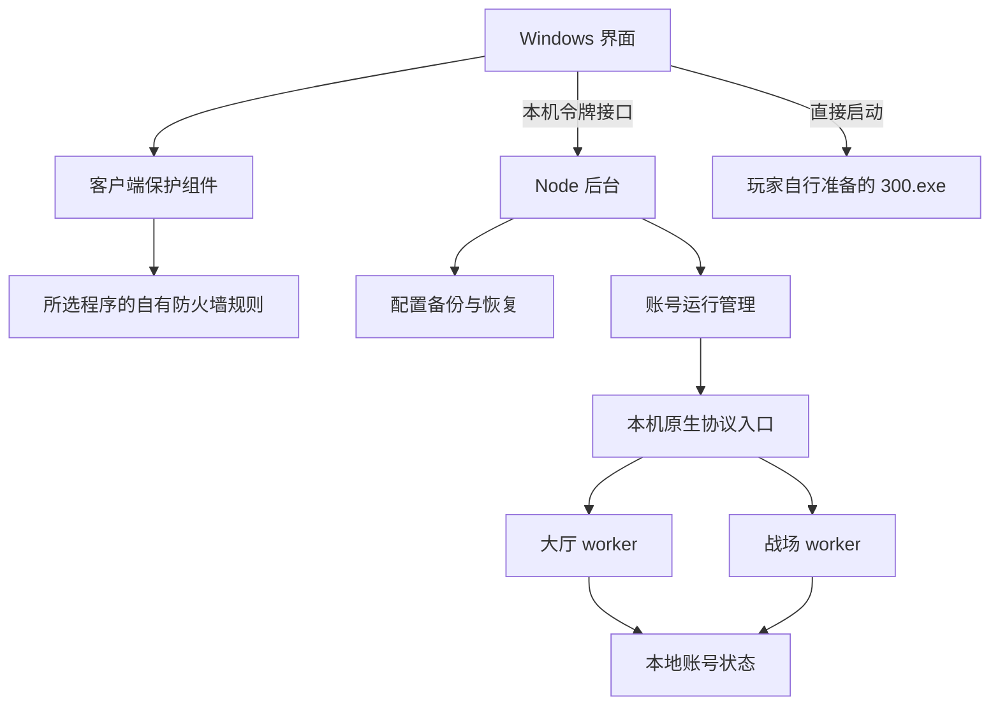

# 架构与数据边界

本文对应 Local300 v0.12 源码协作版。测试与构建命令见 [package.json](../package.json) 的 scripts，修改约定见 [CONTRIBUTING](../CONTRIBUTING.md)。源码目录不包含原版客户端、账号存档或原始抓包。

## 从启动器到游戏服务

界面启动随发行包提供的 Node 后台。后台在回环地址的随机端口提供带随机令牌的接口，串行处理设置、启停和 GM 操作；这些接口不是面向公网的管理服务。后台调用账号运行管理模块，持有本次创建的入口与 worker，只管理自己拥有的服务。

公开工具当前使用一个本地测试账号。底层具备按账号隔离目录、身份、租约及大厅／战场 worker 的机制，这不表示公开版已经提供多用户联机产品。

## 源码定位

| 位置 | 主要职责 |
| --- | --- |
| [app/](../app/) | C# Windows 界面、客户端保护、Node 后台。界面负责显示、文件选择和必要的 Windows 提权；后台负责本地服务生命周期和业务调度。 |
| [client/](../client/) | 客户端检查、连接配置备份、路由切换、冲突检测与恢复。 |
| [server/](../server/) | 原生协议、账号状态、大厅业务、战场模拟及各功能模块。 |
| [tools/](../tools/) | 本地资产导入、源码测试与构建工具；命令入口见 package.json 的 scripts。 |
| [docs/](./) | 架构、已知限制和协议贡献规则。 |

服务端的几个主要接点：

- `player-account-runtime.js`：验证账号与路径，创建原生入口及 worker，维护本次运行的所有权与正常关闭。
- `liveserver.js`：大厅请求入口，连接背包、装备、邮件、符文、充值等业务模块。
- `battle-transport.js`、`battle-runtime.js`、`battle-session.js`：传输、进出场和对局生命周期。
- `battle-sim.js`：权威世界、移动、攻击、弹道和结算事件；`battle-native.js`等模块负责把当前状态转换为客户端帧。
- `hero-runtime.js`：英雄行为钩子与生命周期。默认战斗行为注册黑岩射手和亚瑟王；账号拥有的英雄列表不是已实现英雄列表。
- `public-beta/`：公共账号登录、版本适配、种子提供者、GM、充值、首充与限定活动控制。
- `persistence/`与各业务状态模块：状态读写、事务、恢复和一致性检查。JSON与兼容 SQLite 是显式选择的存储路径，不能同时写同一份业务世界。

修改时先找到业务状态的权威来源，再调整显示帧。重放旧角色或旧对局数据可能覆盖当前状态；客户端有图标、列表或描述，也不等于服务端已经实现对应行为。

## 代码、资产和玩家进度分开管理

| 类别 | 来源与用途 | 是否进入源码仓库 |
| --- | --- | --- |
| 作者代码 | 本仓库中的实现、工具、文档和经过审查的合成测试 | 是，按仓库许可协作 |
| 本地运行资产 | 开发者自行取得的固定 SHA-256 v0.12 分发 EXE中的内嵌资源，由工具仅读取并导入 `.local/assets` | 否 |
| 公共初始种子 | 随上述本地资产导入的初始业务数据，包括27份种子文件 | 否；不是公共源码测试夹具 |
| 玩家进度 | 首次初始化后产生、以后继续保存的本地账号状态 | 否 |
| 原版客户端 | 玩家独立准备的完整游戏客户端及其依赖 | 否 |

资产导入不运行选定的 EXE，也不是更新代理。输入必须匹配工具固定的版本与 SHA-256；不能用任意同名 EXE、个人存档或其他版本资料替换。导入资料的用途与来源不因解包而改变，第三方权利独立于本仓库的代码许可。

初始化仅用于首次创建本地数据。已有账号应经过身份和状态检查后继续使用，不能把“升级工具”实现成重新复制种子。新增测试优先使用明确构造的虚拟数据；不要提交个人进度、数据库、恢复备份或从真实账号裁剪的夹具。

## 业务提交与显示

经济操作先验证权限、归属、数量和容量，再提交状态，成功后才发送回复。失败、待确认和已完成需要保持区别。邮件的已读和已领取是不同状态；分页显示 ID与实际邮件的对应关系也不能丢失。

模拟充值沿用本地钱包及 VIP 账本，通过原生增量更新刷新界面。不能为刷新 VIP 再发送整份旧角色，或用画面数值代替账本。首充仍由玩家在客户端领取；重置资格不清除已有资产。

符文批量强化由原生客户端循环提交单次请求，服务端逐次验证和保存。当前装备宝石全摘则识别客户端的完整四孔请求序列，一次规划返还与最终盘状态。两者不能套用同一种“批量”假设。

## 正常关闭与恢复

“停止请求已接收”不代表保存完成。后台等待自己拥有的 worker正常退出并核对保存结果；无法确认时保留诊断状态，不显示保存成功。贡献代码不得通过删除锁、pending、冻结或未确认记录来绕过检查，也不能拿旧备份覆盖运行中的数据。

客户端连接配置在修改前保存完整备份及哈希。配置被其他程序改动时，恢复应显示冲突并保留当前文件。备份若原本就是本地服配置，只能恢复到该状态，不能称为原服配置。

v0.12客户端保护保留程序原名，对所选程序添加可撤销的自有规则，阻止非回环出站连接。普通停服保留保护；显式回原服流程撤销自有规则并恢复连接配置。保护启动使用已核对的原生直接启动参数。不要恢复旧版“重命名更新器”的建议，也不要把客户端地址恢复当作游戏资源降级。

## 验证层次

单元检查、实际原生 TCP、封装后的程序检查、用户客户端实测分别证明不同事项。报告要记录具体版本与输入，不能用旧产物的结果证明新源码。当前已知限制与贡献方向见 [KNOWN-ISSUES](KNOWN-ISSUES.md)，协议证据的写法见 [PROTOCOL-CONTRIBUTIONS](PROTOCOL-CONTRIBUTIONS.md)。

源码协作版的干净 Windows 开发环境构建仍需独立验证。发行包的同机换目录、空 PATH 和本地服务测试通过，不等同于全新电脑已验证，也不等同于全部原生画面正常。

